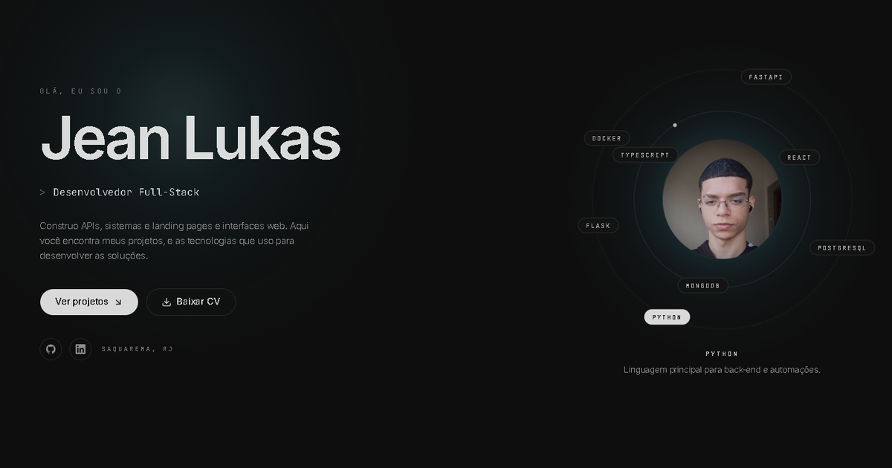

# Portfólio 2.0 · Jean Lukas

Portfólio pessoal de **Jean Lukas**, desenvolvedor Full-Stack com foco em back-end com Python.
Reconstrução do meu portfólio antigo (HTML, CSS e JavaScript puro) em **React, TypeScript e Tailwind CSS**, com o conteúdo separado da interface, animações e currículo em PDF gerado no próprio navegador.

🔗 **No ar:** https://portifolioweb20.vercel.app



## Funcionalidades

- **Página única** com as seções Sobre, Serviços, Tecnologias, Projetos, LinkedIn e Contato
- **Hero animado:** digitação de cargos e "orbit" de tecnologias em volta da foto, com legenda
- **Projetos** com filtro por categoria e dialog com galeria de imagens, destaques e links (online e GitHub)
- **Tecnologias** com dialog de detalhes mostrando onde cada uma foi usada
- **Currículo em PDF** gerado com jsPDF a partir dos mesmos dados do site (baixar ou abrir em nova aba)
- **Contato** com `mailto` e botão de copiar e-mail com aviso (toast)
- **Efeitos de interface:** feixe de luz que acompanha o cursor, cards com inclinação 3D e brilho interno, botões magnéticos, reveal ao rolar e faixa de tecnologias em rolagem contínua
- **Responsivo** (360 px a 1920 px) e acessível: navegação por teclado, foco visível, contraste AA e textos para leitores de tela

## Tecnologias

| Área | Ferramentas |
|---|---|
| Base | React 19, TypeScript, Vite |
| Estilo | Tailwind CSS v4, shadcn/ui (Radix), fontes Inter e JetBrains Mono (Fontsource) |
| Animação | Framer Motion (`motion`) |
| Ícones | lucide-react e SVGs do Simple Icons |
| PDF | jsPDF (carregado sob demanda) |
| Qualidade | oxlint, checagem de tipos no build |
| Deploy | Vercel (deploy automático a cada push na `main`) |

Lighthouse em produção: **mobile 91 · 100 · 100 · 100** e **desktop 100 · 100 · 100 · 100** (Performance, Acessibilidade, Boas práticas, SEO).

## Como rodar

Requisitos: Node.js e npm.

```bash
npm install
npm run dev       # servidor de desenvolvimento
npm run build     # checagem de tipos + build de produção em dist/
npm run preview   # serve o build localmente
npm run lint      # oxlint
```

## Estrutura

```
src/
  data/         conteúdo do site (perfil, projetos, tecnologias, formação, experiência...)
  sections/     seções da página (hero, sobre, serviços, tecnologias, projetos, contato)
  components/   layout (header, footer, spotlight), componentes comuns e shadcn/ui
  hooks/        digitação, seção ativa, copiar e-mail, currículo, inclinação 3D
  lib/          variants de animação e gerador do currículo PDF
  assets/       foto, ícones das tecnologias e imagens dos projetos (WebP)
docs/           documentação do desenvolvimento (estado, decisões, arquitetura, etapas)
```

Todo o conteúdo fica em `src/data/*.ts`; os componentes só renderizam. Para **adicionar um projeto**, basta incluir um objeto em `src/data/projects.ts` e colocar as imagens (WebP) em `src/assets/images/projects/<pasta>/`. O site e o currículo em PDF são atualizados juntos.

## Créditos

- Layout inspirado num modelo gerado no Base44; todo o conteúdo é real e próprio.
- Ícones de marca: [Simple Icons](https://simpleicons.org) (CC0).

## Contato

- E-mail: jeanlukasdemarinscosta@gmail.com
- GitHub: [Jeanlukas1](https://github.com/Jeanlukas1)
- LinkedIn: [Jean Lukas](https://www.linkedin.com/in/jean-lukas-marins-costa-0998ab301/)
